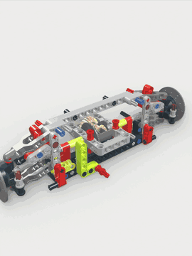
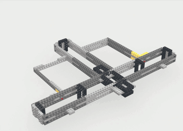
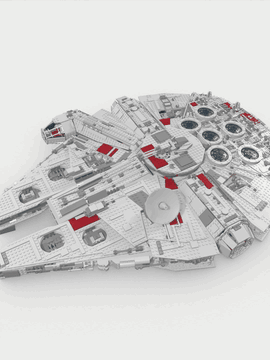
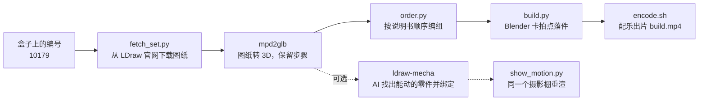

# LEGO 拼装视频 Skill

给 AI 一个乐高套装编号，它从 LDraw 官网下载这套乐高的文字图纸，按官方说明书的顺序在电脑里一步步拼出来，卡着音乐节拍渲染成视频；还能把模型交给 [ldraw-mecha](https://github.com/anteloc/ldraw-mecha)，让本来能动的零件动起来。

*Give an AI agent a LEGO set number. It downloads the set's LDraw model, builds it step by step in the order of the paper manual, renders a beat-synced build video in Blender, and can make the set's real mechanisms move.*

| 42115 兰博基尼 Sián，3,696 块 | 10179 千年隼，5,254 块 | 千年隼的雷达碟转起来 |
|---|---|---|
|  |  |  |

## 用法

装进 Claude Code：

```bash
git clone https://github.com/OceanJy333/lego-build-video.git
mkdir -p ~/.claude/skills && cp -r lego-build-video/skills/lego-build-video ~/.claude/skills/
```

然后跟它说一句：

> 按说明书的顺序把 10179 拼出来，做成卡点视频

用 Codex、Cursor 等其他 AI 时，把 [SKILL.md](skills/lego-build-video/SKILL.md) 交给它即可。自己手动跑，命令也全在这份文件里。

## 全流程



| 步 | 做什么 | 脚本 | 耗时（Apple M 系列） |
|---|---|---|---|
| 1 | 安装 Blender、ffmpeg、bun、mpd2glb、LDraw 零件库 | `setup.sh` | 约 3 分钟 + Blender 下载 |
| 2 | 按编号从 LDraw 官方模型库下载图纸，打印作者与授权 | `fetch_set.py` | 约 1 分钟 |
| 3 | 转 3D 并按说明书顺序编组 | `mpd2glb` + `order.py` | 15 秒到 2 分钟 |
| 4 | 先渲 4 帧预览，再整段渲染 | `build.py` | 3,700 块约 30 分钟，5,000 块约 1 小时 |
| 5 | 配乐，爆发点对上第 16 拍 | `encode.sh` | 几秒 |
| 6 | 可选：让机构动起来 | ldraw-mecha + `show_motion.py` | 大套装 30–60 分钟 |

需要 macOS 与 Homebrew（Linux 先用包管理器装 Blender 4.2+、ffmpeg、unzip），预留约 3 GB 磁盘（Blender、零件库和渲染帧）。

## 怎么做到的

1. 乐高爱好者早就把官方说明书写成了文字图纸 LDraw：一块零件一行，写着颜色、位置、朝向和零件编号，`0 STEP` 标出说明书的每一步。[LDraw 官方模型库](https://library.ldraw.org/omr)收录了约 1,470 套官方套装。
2. [mpd2glb](https://github.com/anteloc/mpd2glb) 把图纸转成 3D 模型，并保留每块零件属于哪个子模型、第几步。
3. `order.py` 按说明书的走法排序：子模型内部按它自己的 `STEP`，子模型装上去时整体算完成；展示铭牌这类不属于模型本身的子模型会被藏起来。
4. `build.py` 在免费的 Blender 里把零件分批：前一半落在 16 拍铺垫上，后一半落在爆发后的 32 个半拍上，镜头每小节切一次，最后环绕成品。
5. 想让它动，[ldraw-mecha](https://github.com/anteloc/ldraw-mecha) 让 AI 读图纸、找出真有铰链和转轴的零件并绑定关节；它只动模型里真有的机构（千年隼是雷达碟和两座炮塔，舱门和起落架没有铰链，不会动）。

## 致谢与授权

- 代码：MIT。
- LDraw 模型与零件库：CCAL 2.0。发视频时请在简介里保留模型作者，`fetch_set.py` 会打印出来。
- [mpd2glb](https://github.com/anteloc/mpd2glb)（MIT）与 [ldraw-mecha](https://github.com/anteloc/ldraw-mecha)（AGPL）来自 anteloc；本仓库不包含它们的代码，按需下载调用。
- LEGO 是乐高集团的商标，本项目与乐高集团无关。
